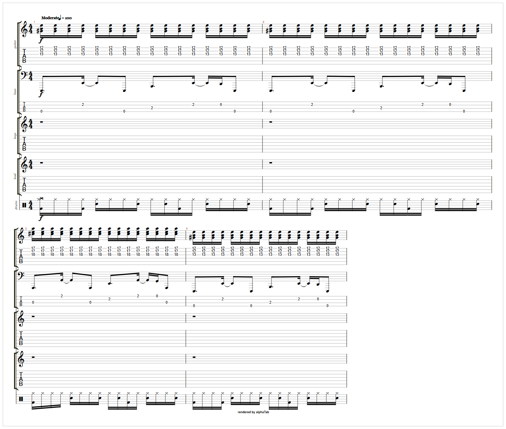

# Transcription and song sections: research and measurements

Follow-up to features 4, 5, 11, 12, 15, 16 and 17 of [implementation-report.md](implementation-report.md): notes and tabs for each instrument, key, chords, tuning, imported notation, and song sections (verse, chorus, solo, ...). Experiments: [../experiments/](../experiments/) (scripts named below); numbers: [../experiments/results/](../experiments/results/).

> **Status (23 November 2026):** draft. The laptop ran on battery during this work, which caps its GPU at 20 W (210 MHz); the GPU-bound runs (SongFormer on all test songs, YourMT3+ on the test songs, All-In-One, the string network) are queued for when it is plugged in. Sections marked *pending* are filled in then.

## Summary

| Function | Today in the app | Best option found | Measured | Recommendation |
|---|---|---|---|---|
| Song sections | none | SongFormer (2025), decided at the app's bar starts (written here) | unseen live recordings: 56 % of section starts within 0.5 s, labels right 60 % of the time; two human experts agree on 64 % / 70 % | use it, editable; GPU recommended |
| Notes per instrument | none | YourMT3+ (one model, all instruments) and Demucs + Basic Pitch + ADTOF, combined per instrument | note F on full mixes: bass 0.47, guitar 0.49 (Demucs + Basic Pitch), keys 0.32, leads 0.23 (YourMT3+), drums 0.95 (ADTOF) | combine; present as a draft to correct; test MuScriptor |
| Tabs (strings and frets) | none | fingering search + a network that hears the string (written here) | real guitar: 89 % of notes on the guitarist's string (search alone 58 %, lowest fret 33 %); tab F 0.82 from YourMT3+ notes | use both; check the network on other guitars first |
| Notation (bars, rhythm) | none | beat-grid quantization → Guitar Pro 5 → alphaTab (written here) | correctly found notes: 87–100 % at the exact score position with the true beats; rhythm within the beat right for 89–100 % with the app's own grid | use it, after the user has checked the grid |
| Chords | chroma templates | madmom CNN + CRF | real guitar recordings: 58 % → 76 % of the time right | switch |
| Key | none | madmom CNN | real recordings: 64 % exact, 78 % among the best two (librosa templates: 49 % / 70 %) | madmom; show the two best keys |
| Tuning | librosa | librosa | real recordings: median 4 cents off A440, 12 % more than 15 cents; transcription loses up to 3/4 of its notes when the recording is detuned | keep; always correct the tuning before transcribing |

## What exists in 2026

**Multi-instrument transcription**
- [YourMT3+](https://arxiv.org/abs/2407.04822) (Chang et al., MLSP 2024; [code and weights](https://huggingface.co/spaces/mimbres/YourMT3), Apache-2.0): one model for 13 instrument classes, including drums and singing voice. Not a pip package; it runs from the Space's code ([yourmt3_runner.py](../experiments/yourmt3_runner.py)). 561 MB checkpoint, 15–40 s per song on this laptop's GPU when plugged in (its decoder is autoregressive: dense songs take longer).
- [MuScriptor](https://huggingface.co/papers/2607.08168) (Mirelo / Kyutai, July 2026): the strongest open model reported so far (its model card: onset F 60.4 vs 32.5 for YourMT3+ on its benchmark). Inference code MIT, but the weights are **CC BY-NC 4.0 and gated** ([model card](https://huggingface.co/MuScriptor/muscriptor-large)): downloading needs a Hugging Face account that accepts the terms. Not tested here; worth testing with the user's token.
- [Basic Pitch](https://github.com/spotify/basic-pitch) (Apache-2.0) per separated stem, ADTOF for drums: the pipeline the implementation report planned.
- The [2025 AMT Challenge](https://arxiv.org/pdf/2603.27528) found multi-instrument transcription still far from solved: a YourMT3 variant ranked near the top, and scores drop sharply on dense mixes.

**Tabs**
- [TabCNN](https://ir.webis.de/anthology/people/a/andrew+wiggins/) (Wiggins & Kim, ISMIR 2019): audio → string and fret per frame, trained on GuitarSet. [Fretting-Transformer](https://arxiv.org/html/2506.14223v1) (2025) and [TART](https://arxiv.org/html/2510.02597v1) (2025) map MIDI to tab with transformers; neither has released weights.

**Song sections**
- [SongFormer](https://arxiv.org/abs/2510.02797) (ASLP-lab, 2025; [code](https://github.com/aslp-lab/songformer), [weights](https://huggingface.co/ASLP-lab/SongFormer)): MuQ and MusicFM self-supervised embeddings at 30 s and 420 s, boundaries and 8 labels (intro, verse, pre-chorus, chorus, bridge, instrumental, outro, silence). Trained on Harmonix and a large pseudo-labelled set.
- [All-In-One](https://github.com/mir-aidj/all-in-one) (Kim & Nam, WASPAA 2023; MIT): Demucs stems + neighbourhood attention; beats, bars and labelled sections, trained on Harmonix. Needs NATTEN (Linux only; its wheel server's certificate had expired, so it was built from source and patched).
- Classic baseline: Laplacian segmentation (McFee & Ellis 2014) in librosa.

**Key and chords**: madmom's CNN key classifier ([Korzeniowski & Widmer 2018](https://arxiv.org/abs/1808.05340)) and CNN + CRF chord recognizer; madmom's model files are CC BY-NC-SA.

## Test data

| Set | What | Answers | Used for |
|---|---|---|---|
| **SALAMI, Internet Archive part** (147 songs, ~6 min each) | live recordings, many genres, freely downloadable ([SALAMI](https://ddmal.music.mcgill.ca/research/salami)) | section functions by 1–2 annotators | sections; **no tested model was trained on it** |
| **Harmonix** (49 songs) | pop / rock, YouTube audio aligned to the annotations | sections, beats | sections; in SongFormer's and All-In-One's training data, so optimistic |
| **Score songs with stems** (28 songs, 41 min) | the beat-tracking score songs rendered again with every instrument's stem and exact notes ([render_score_stems.py](../experiments/render_score_stems.py)): drums, bass, clean and distorted guitars, keys, leads | exact notes, bars, section starts | transcription per instrument, notation, sections |
| **GuitarSet** (360 excerpts, 6 guitarists) | real acoustic guitar, microphone recording | notes with string and fret (hexaphonic pickup), chords, key | tabs, chords; guitarist 05 held out |
| **GTZAN** (837 excerpts with a key) | real recordings, 9 genres | key ([Kraft, Lerch & Zölzer](https://github.com/alexanderlerch/gtzan_key)) | key |

## Results

### Song sections
Metrics (mir_eval): **HR.5F / HR3F** = section starts found within 0.5 s / 3 s (F-measure); **PWF** = are repeated parts grouped alike; **ACC** = share of time with the right label (intro, verse, chorus, bridge, instrumental, outro, silence).

SALAMI: the 80 songs with two annotations (the same songs for every row). Score songs: exact section starts; their labels are partly ad hoc ("a", "groove"), so only boundaries count.

| Method | SALAMI HR.5F | HR3F | PWF | ACC | Score songs HR.5F | HR3F |
|---|---|---|---|---|---|---|
| Laplacian (librosa), snapped to bars | 0.25 | 0.39 | 0.54 | – | 0.37 | 0.42 |
| SongFormer, as published | 0.47 | 0.54 | **0.70** | **0.61** | 0.77 | 0.77 |
| SongFormer, nearest bar start within 2 s | 0.49 | 0.54 | 0.70 | 0.61 | – | – |
| **SongFormer, decided at bar starts** (`songformer_bars`) | **0.56** | **0.60** | 0.69 | 0.60 | **0.79** | **0.80** |
| All-In-One | *pending* | | | | | |
| Second human annotator | 0.64 | 0.72 | 0.77 | 0.70 | – | – |

- **The ceiling is low:** two experts agree on only 64 % of section starts (within 0.5 s) and 70 % of the labels.
- **SongFormer reaches most of it on music it never saw:** 87 % of the human level for section starts (decided at bar starts), 91 % for grouping repeated parts, 86 % for labels. The classic method gets less than half as many starts right.
- **Deciding at bar starts** (`songformer_bars` in [test_structure.py](../experiments/test_structure.py)): the boundary probability is read at each bar start of the app's grid, a bar start becomes a section start when the probability is above a threshold and the largest within 2 bars, and each section takes the label with the highest mean probability. The lag (0.5 s) and threshold (0.4) were tuned on the score songs only. +9 points on SALAMI, and every section starts on a bar line, ready for loops.
- **Labels** (SALAMI, share of each true label's time): instrumental 88 %, intro 75 %, chorus 71 %, verse 65 %, outro 27 %, bridge 18 %. Bridges are mostly called instrumental (34 %) or verse (27 %); outros instrumental (41 %) or chorus (23 %). The "silence" of live recordings (applause, talking) becomes intro or outro.
- **Harmonix** (48 songs, in SongFormer's training data): HR.5F 0.45, HR3F 0.60, ACC 0.66 as published; 0.46 / 0.63 / 0.65 decided at bar starts. Not much better than on unseen SALAMI, so the training-set advantage is small here (our YouTube copies differ from the CDs it was trained on).
- **A false lead worth recording:** the first 4 Harmonix songs had every boundary ~1.7 s early, and a 2 s lag correction looked like a big gain. Over all 48 songs the median lag is −0.09 s (SALAMI −0.17 s, score songs −0.05 s); applied to SALAMI, the 2 s correction would have dropped HR.5F to 0.01. Hence the decoder's lag was tuned on the score songs only.
- **Cost:** ~1–2 min per song on this laptop's 6 GB GPU after [songformer_patch.py](../experiments/songformer_patch.py) (the stock script pages GPU memory: ~3–4 min). Weights: MuQ 1.3 GB + MusicFM 1.3 GB + SongFormer 0.1 GB.

### Notes per instrument (score songs)
Note F-measure: right pitch, onset within 50 ms. Drums: onset F per drum (kick, snare, hi-hat, toms, cymbals), averaged.

| Pipeline | All pitched | Bass | Guitar | Keys | Lead | Drums |
|---|---|---|---|---|---|---|
| Basic Pitch on the true stems (best case) | 0.66 | 0.63 | 0.67 | 0.40 | 0.80 | 0.97 |
| htdemucs_6s → Basic Pitch / ADTOF | 0.43 | **0.47** | **0.49** | 0.10 | 0.18 | **0.95** |
| YourMT3+ on the mix | **0.57** | 0.38 | 0.45 | 0.29 | 0.23 | 0.63 |
| YourMT3+, notes moved to the loudest Demucs stem | 0.57 | 0.33 | 0.36 | 0.10 | 0.21 | 0.95 |
| YourMT3+ labels, ADTOF drums, low notes to bass if the bass stem dominates | 0.57 | 0.41 | 0.42 | **0.32** | **0.23** | 0.95 |
| YourMT3+ on the true stems (27 songs; best case) | – | 0.54 | 0.47 | **0.73** | 0.52 | 0.84 |

**A better separator** (8 songs only: BS-RoFormer-SW ran ~5 min per song while the CPU was busy, so it was stopped early). Basic Pitch / ADTOF on the stems of each separator, same 8 songs:

| Separator | Bass | Guitar | Keys | Lead | Drums |
|---|---|---|---|---|---|
| htdemucs_6s (the app's) | 0.48 | 0.47 | 0.02 | 0.15 | 0.97 |
| [BS-RoFormer-SW](https://github.com/openmirlab/bs-roformer-infer) (6 stems) | **0.56** | **0.50** | 0.00 | **0.23** | 0.97 |

The cleaner stems help bass and leads by 8 points. Keys fail with both separators: the piano stem is the weak link. Yet YourMT3+ transcribes keys well from a clean keys stem (0.73), so a better piano separation would unlock keys. BS-RoFormer's weights licence is unclear, and it is slower than Demucs.

- **YourMT3+ finds more notes, but often names the wrong instrument.** Over all pitched notes it beats separation + Basic Pitch (0.57 vs 0.43). Per instrument it finds 60 % of the guitar notes and 73 % of the keys notes (Demucs + Basic Pitch: 48 % / 46 %), but labels a third to half of them as another instrument: a third of the bass notes come out as "keys". Separation keeps the bass label right 98 % of the time.
- **Drums:** ADTOF on the Demucs drum stem (0.95) is far better than YourMT3+'s drums (0.63; cymbals and toms 0.3). Synthetic drums are easy; the ADTOF authors report ~0.88 on real recordings.
- **Moving notes to the loudest stem** (tried to fix the labels) made things worse: Demucs's piano stem is unreliable, so keys notes landed in "other".
- Separation costs a third of the notes; keys and leads mostly vanish with Demucs + Basic Pitch (Demucs's piano stem fails, as the implementation report found).
- Best per instrument so far: bass and guitar from Demucs + Basic Pitch, keys and leads from YourMT3+, drums from ADTOF.

**Real recordings (rough check).** Three real songs whose fan-made Lakh MIDI file aligned well (Blackened, Dead & Bloated, Girls & Boys; [test_real_transcription.py](../experiments/test_real_transcription.py)) give an approximate answer key. It is rough: arrangements differ, octaves too, and the alignment is ~45 ms off. So: onset within 100 ms, exact pitch / pitch class (octave forgiven).

| Real songs | Bass | Guitar | Keys | Lead / voice | Drums |
|---|---|---|---|---|---|
| htdemucs_6s → Basic Pitch / ADTOF | **0.18 / 0.29** | **0.14 / 0.20** | 0.07 / 0.19 | 0.05 / 0.11 | **0.51** |
| YourMT3+ on the mix | 0.03 / 0.06 | 0.07 / 0.12 | 0.06 / 0.25 | 0.07 / 0.14 | 0.42 |

The absolute numbers mostly measure the answer key. The comparison holds, though: on real rock mixes YourMT3+ falls apart for bass and guitar. On American Woman it wrote most of the distorted riff as strings and brass, and only 26 notes as guitar. Separation followed by per-stem transcription is the safer default; YourMT3+ only for parts nothing else finds (keys, leads).

### Tabs (GuitarSet guitarist 05, real recordings)
| Notes from | Note F | Tab F (right string too) | Right string, of the notes found |
|---|---|---|---|
| the annotation (perfect notes) | 1.00 | 0.50 | 58 % |
| Basic Pitch | 0.81 | 0.38 | 55 % |
| YourMT3+ | 0.94 | 0.46 | 56 % |

- Both transcribers saw parts of GuitarSet in training, so their note scores are optimistic. The string choice is not learned by either.
- **The string is the bottleneck**: [tablature.py](../experiments/tablature.py) chooses strings by a fingering search (hand span, position, movement between chords; Viterbi), tuned on guitarists 00–04: 58 % on guitarist 05 vs 33 % for "lowest fret". Many "wrong" strings are equally playable alternatives; a guitarist would accept them, the metric does not.
**Hearing the string** ([test_string_model.py](../experiments/test_string_model.py)): the same pitch sounds different on different strings. A small TabCNN-style network (CQT frames → for each string, which fret or silence; trained on guitarists 00–04; about an hour on the CPU including feature extraction) gives each candidate string/fret a probability; the fingering search adds it to its playability costs.

| Guitarist 05 (held out) | Right string (true notes) | Tab F from Basic Pitch notes | Tab F from YourMT3+ notes |
|---|---|---|---|
| fingering search alone | 0.58 | 0.38 | 0.46 |
| network alone | 0.88 | – | – |
| **search + network** | **0.89** | **0.70** | **0.82** |

- The network nearly doubles the share of right strings. The search still matters for playability (it keeps chord shapes possible), but the sound decides.
- **Other guitars:** all of GuitarSet was played on one acoustic guitar with the same microphone, so the network may have learned *that* guitar. On [IDMT-SMT-Guitar](https://zenodo.org/records/7544110)'s electric guitars (true notes, string annotations):

  | Right string | Licks: Aristides / Stratocaster / Les Paul (1146 notes each) | Pieces, Ibanez (90 notes) | Scales up to fret 20 on one string |
  |---|---|---|---|
  | fingering search alone | 0.50 / 0.51 / 0.54 | 0.49 | 0.36 |
  | + network trained on GuitarSet only | **0.65 / 0.68 / 0.65** | **0.67** | 0.41–0.43 |

  The network still helps a lot (+12 to +18 points), but much less than on the guitar it was trained on (0.89). The scales are a deliberate worst case: chromatic runs up one string, which no fingering rule would choose.
- **Trained on several guitars** (`cross-guitar`: GuitarSet 00–04 + IDMT Aristides, Stratocaster and Ibanez; tested on the Les Paul, held out):

  | Right string | Les Paul licks | Les Paul scales | GuitarSet guitarist 05 |
  |---|---|---|---|
  | fingering search alone | 0.54 | 0.36 | 0.58 |
  | network trained on GuitarSet only | 0.65 | 0.43 | 0.89 |
  | **network trained on several guitars** | **0.83** | **0.52** | **0.89** |

  Variety in training closes most of the gap without losing anything on GuitarSet. Caveat: the same licks, played by the same person on the other guitars, were in the training data, so part of the gain may be his fingering habits rather than the guitar's sound. A cleaner test needs a second player (EGDB).
- Still to check: Demucs guitar stems from band mixes (separation artifacts, distortion, several guitars).

### Notation
[notation.py](../experiments/notation.py) places notes on the beat grid (sixteenths or triplets per beat), fills short gaps, splits notes at bar lines with ties, and writes Guitar Pro 5 (tab + notation for guitar and bass, percussion for drums). alphaTab renders it ([render_notation.py](../experiments/render_notation.py)). Transcribed guitar chords can contain notes no hand reaches together (frets 1–3 and 17–20 at once); [tablature.playable_subset](../experiments/tablature.py) drops the fewest notes so every chord fits on distinct strings within 5 frets. On GuitarSet it drops nothing; on the band-mix score songs it removes 11 % of YourMT3+'s guitar notes, raising their precision from 0.49 to 0.54 at a 1-point cost in recall.

| Notes | Bass | Guitar | Keys | Lead |
|---|---|---|---|---|
| played notes (quantization alone), share at the exact score position | 1.00 | 0.95 | 1.00 | 1.00 |
| htdemucs_6s + Basic Pitch: correctly found notes at the exact position | 0.97 | 0.87 | 0.91 | 0.99 |

Guitar loses a little because strummed chords are spread over ~30 ms.

With a detected beat grid instead of the score's (correctly found notes):

| Grid | Right place within the beat (rhythm) | Right bar and beat | Songs with the tempo octave wrong |
|---|---|---|---|
| Beat This! peaks | 89–100 % | 62–93 % | 5 of 28 |
| the app's grid (Beat This! + the app's decoder) | 89–100 % | 71–90 % | 9 of 28 |

The rhythm figures come out right; whole-bar positions break where the grid itself is off. These score songs were written to break beat trackers (half-time feels, odd meters, rubato); the app's ½× / 2× and bar-start hints fix exactly those cases, and notation would be generated after the user has checked the grid.

### Imported notation on real recordings
Nine downloaded Harmonix songs have MIDI files in the [Lakh MIDI Dataset](https://colinraffel.com/projects/lmd/) (fan-made, 1–4 versions each). Aligned to the YouTube recording, the MIDI's own beats should land on the annotated beats ([test_import_alignment.py](../experiments/test_import_alignment.py); 5 songs left out because their annotations do not line up with the YouTube audio):

| Song | Beats within 100 ms (synctoolbox) | + snapped to the app's beats |
|---|---|---|
| Blackened (3 files) | 0.76 | 0.79 |
| Dead & Bloated (2 files) | 0.88 | 0.94 |
| Girls & Boys (2 files) | 0.64–0.73 | 0.74–0.76 |
| American Woman | 0.23 | 0.32 |
| **mean of 8 files** | **0.71** | **0.76** |

- Median error 42–64 ms where it works (the synthetic test in the implementation report: ~20 ms); the files for one song all aligned alike. American Woman's file is a different arrangement and fails.
- **Aligning via a transcription** (YourMT3+ notes of the recording vs the MIDI's notes, both symbolic) was worse: 0.59 of beats within 100 ms (0.69 snapped to beats), against 0.71 / 0.76 for aligning the audio directly. The transcription's errors hurt more than timbre does.

### Chords (GuitarSet comping, 180 excerpts, real recordings)
| Method | Major / minor right (time) | Root right | Chord changes vs truth |
|---|---|---|---|
| the app today (CQT templates, per beat, Viterbi) | 0.58 | 0.63 | 0.71× |
| madmom CNN + CRF | **0.76** | **0.80** | 1.2× |

The app's detector was only ever tested on one synthetic song (98 %). On real playing with seventh chords and voicings it is right 58 % of the time; madmom's network is right 76 %.

Also tried ([test_chords.py](../experiments/test_chords.py)):
- **One chord per bar** (the app's detector on bars instead of beats): 0.33. These excerpts often change chords twice per bar.
- **Chords from transcribed notes** (pitch classes sounding in each beat → the app's templates), guitarist 05 only: Basic Pitch notes 0.55, YourMT3+ notes 0.53, vs 0.52 for the app's audio detector and 0.66 for madmom on the same 30 excerpts. Transcription does not make a better chord detector.

### Tuning
- 196 real recordings (Harmonix + SALAMI): median 4 cents from A440; 12 % are more than 15 cents off, 7 % more than 25 cents ([test_tuning.py](../experiments/test_tuning.py)).
- librosa estimated synthetic detunings of ±25 / ±45 cents within 4 cents.
- **Transcription needs the correction.** YourMT3+ on 8 score songs played back detuned (note F, all pitched notes):

  | Detuning | −45 cents | −25 cents | 0 | +25 cents | +45 cents |
  |---|---|---|---|---|---|
  | as recorded | 0.15 | 0.37 | 0.56 | 0.47 | 0.35 |
  | tuning detected, resampled to A440 first | 0.54 | 0.56 | – | 0.56 | 0.54 |

  Near a quarter tone, notes land between semitones and are named wrong. Detecting the tuning and resampling before transcription recovers everything.

### Key (GTZAN, 837 real excerpts, 9 genres)
[test_key.py](../experiments/test_key.py). MIREX weighted score: exact key 1, a fifth off 0.5, relative 0.3, parallel 0.2.

| Method | Exact key | Weighted | Right key among the best two |
|---|---|---|---|
| **madmom CNN** (Korzeniowski & Widmer 2018) | **0.64** | **0.70** | **0.78** |
| librosa chroma, drums removed (HPSS), EDMKey profile | 0.49 | 0.58 | 0.70 |
| librosa chroma, drums removed, Krumhansl profile | 0.49 | 0.59 | 0.68 |
| librosa chroma, Krumhansl profile | 0.46 | 0.56 | 0.64 |
| librosa chroma, Temperley / Bellman-Budge profiles | 0.44 | 0.50–0.53 | 0.60–0.61 |

- Removing drums first helps every profile by 2–3 points.
- madmom's network is 15 points better than any template method. The typical miss of every method is the parallel key (C major vs C minor: 11–16 %), then the fifth.
- A "pick one of two" control would make the key right for ~4 of 5 songs with madmom.

## Recommendations

**Song sections** — *numbers pending the full SongFormer and All-In-One runs.*
- Run SongFormer as a background job after the beat analysis, in a worker process like the stem separation ([songformer_patch.py](../experiments/songformer_patch.py) makes it fit a 6 GB GPU: ~1–1.5 min per song).
- Decide section starts at the app's bar starts from SongFormer's frame outputs (`songformer_bars`), so sections line up with loops.
- Show them as a lane of named, coloured blocks the user can rename, move by a bar, split and merge; keep the user's edits. Even two experts agree on only 64 % of section starts, so editing is part of the feature, not a fallback.
- Licence: SongFormer needs MuQ, whose weights are CC BY-NC 4.0 (fine for personal use). All-In-One (MIT) is the permissive alternative.

**Notes and tabs**
- Present transcription as a draft to correct by ear. On full mixes 40–60 % of the notes per instrument come out right (synthetic songs), drums ~95 %.
- Pipeline:
  1. Separate (already in the app).
  2. Transcribe: Basic Pitch on the bass and guitar stems, YourMT3+ for keys and leads (it is the only one that gets them at all), ADTOF on the drum stem.
  3. Quantize to the app's beat grid, after the user has checked the grid.
  4. Strings and frets: the fingering search, plus the string network once it holds up on other guitars.
  5. Write Guitar Pro 5 in the backend (pyguitarpro). Render and play with alphaTab in the frontend.
- One tab per instrument, with a "show notation / tab" toggle and a loop-synced cursor (alphaTab's player follows the recording through sync points from the beat grid).
- Test MuScriptor (Hugging Face token needed; CC BY-NC 4.0). Its reported multi-instrument scores are about twice YourMT3+'s.

**Chords**: switch to madmom's CNN + CRF (76 % vs 58 % on real guitar). madmom needs a C compiler on Windows; check the [madmom-onnx](https://pypi.org/project/madmom-onnx/) package, or port the small network. Model licence CC BY-NC-SA. Keep chords editable.

**Key**: madmom's CNN, showing the two best keys (right ~4 of 5 times). Without madmom: librosa chroma with drums removed and the EDMKey profile (49 % / 70 %).

**Tuning**: keep librosa's estimate and show it ("this recording is 30 cents flat"). Before transcribing, always resample the audio to A440 by the estimated amount, then shift the notes' times back. Without that, a quarter-tone-off recording loses three quarters of its notes.

**Imported notation**: synctoolbox alignment, then snap the aligned beats to the app's beat grid: ~76 % of beats within 100 ms on real songs. The rest needs a manual sync editor: drag a bar line to where it is heard; alphaTab's Media Sync Editor is a model. Lakh MIDI files exist for only ~7 % of songs and vary in quality; the user's own Guitar Pro / MusicXML files remain the main source.

## How it would fit into the app

The app already runs heavy models as background jobs (beats, stems in a worker process, chords) and stores results per song. The new parts follow the same pattern:

| Job | Runs after | Model / cost | Stored as | Shown as |
|---|---|---|---|---|
| sections | beats | SongFormer (patched), GPU ~1–2 min; decided at the app's bar starts | `sections.json` (start, end, label, edited by user) | a lane of coloured, named blocks; rename / move by a bar / split / merge; click to loop a section |
| tuning | download | librosa, seconds | `analysis.json` (cents) | "30 cents flat"; transcription resamples first |
| key | stems | madmom CNN, seconds | `analysis.json` (two best keys) | key with a "or …" switch |
| chords | beats + stems | madmom CNN + CRF, seconds | `chords.json` (as now) | the existing chord lane |
| notes | stems + tuning + checked beat grid | Basic Pitch (bass, guitar), YourMT3+ (keys, leads), ADTOF (drums); ~1 min | `notes/<instrument>.mid` | – |
| notation | notes | quantize + fingering search (+ string network) → Guitar Pro 5 | `notation.gp5` | alphaTab: one track per instrument, tab for guitar and bass, cursor following the recording |

Things to build on the frontend: the section lane, an alphaTab view synced to the player (the beat grid gives the sync points), and editing (sections, chords, wrong notes).

## What is still open
- **MuScriptor**: the strongest published transcription model (2026); test it as soon as a Hugging Face token is available (weights gated, non-commercial).
- **Piano / keys separation**: the bottleneck for keys (YourMT3+ gets 0.73 from a clean keys stem, < 0.1 from separated ones).
- **String network**: train on more guitars and players (EGDB, IDMT, GuitarSet); check it on Demucs guitar stems from band mixes.
- **All-In-One on the GPU**: needs NATTEN built with CUDA (the CUDA toolkit in WSL); here it ran on the CPU with one model of its 8-model ensemble.
- **Real-recording ground truth for transcription**: the Lakh-based check is rough. A few hand-checked transcriptions of real songs would make the numbers trustworthy.
- **Notation polish**: voices (melody vs accompaniment), key signatures, triplet feel / swing, repeats; slurs and bends for guitar.

## Sources
- Chang et al., [YourMT3+](https://arxiv.org/abs/2407.04822), MLSP 2024; [Hugging Face Space](https://huggingface.co/spaces/mimbres/YourMT3)
- [MuScriptor paper](https://huggingface.co/papers/2607.08168) and [model card](https://huggingface.co/MuScriptor/muscriptor-large)
- [Results of the 2025 AMT Challenge](https://arxiv.org/pdf/2603.27528)
- Hao et al., [SongFormer](https://arxiv.org/abs/2510.02797); [code](https://github.com/aslp-lab/songformer)
- Kim & Nam, [All-In-One](https://arxiv.org/pdf/2307.16425v1.pdf), WASPAA 2023; [code](https://github.com/mir-aidj/all-in-one)
- Smith et al., [SALAMI](https://ddmal.music.mcgill.ca/research/salami), ISMIR 2011
- Korzeniowski & Widmer, [Genre-agnostic key classification with CNNs](https://arxiv.org/abs/1808.05340), ISMIR 2018
- [GTZAN key annotations](https://github.com/alexanderlerch/gtzan_key)
- Hamberger et al., [Fretting-Transformer](https://arxiv.org/html/2506.14223v1), 2025; [TART](https://arxiv.org/html/2510.02597v1), 2025
- [MuQ model card](https://huggingface.co/OpenMuQ/MuQ-large-msd-iter) (weights CC BY-NC 4.0, code MIT); [madmom](https://github.com/cpjku/madmom) (model files CC BY-NC-SA 4.0); [madmom-onnx](https://pypi.org/project/madmom-onnx/)
- Wiggins & Kim, Guitar tablature estimation with a CNN (TabCNN), ISMIR 2019 ([ISMIR anthology](https://ir.webis.de/anthology/people/a/andrew+wiggins/))
- Datasets: [GuitarSet](https://guitarset.weebly.com/), [IDMT-SMT-Guitar](https://zenodo.org/records/7544110), [SALAMI annotations](https://github.com/DDMAL/salami-data-public), [Harmonix Set](https://github.com/urinieto/harmonixset), [Lakh MIDI Dataset](https://colinraffel.com/projects/lmd/)
- [Basic Pitch](https://github.com/spotify/basic-pitch); [alphaTab](https://alphatab.net); [synctoolbox](https://github.com/meinardmueller/synctoolbox)
